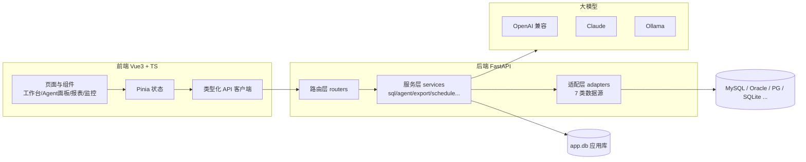

# DataMind —— 通用化数据库 Agent Web 应用

## 一、项目速览

DataMind 是一个前后端分离的 **AI Agent 驱动的数据库查询与运维工作台**。它把「自然语言查询、SQL 工作台、元数据管理、可视化报表、权限审计、运维监控」整合成一个闭环，让**不会写 SQL 的业务人员也能安全地查数据，会写 SQL 的技术人员效率更高**。

| 维度 | 内容 |
|---|---|
| 项目类型 | 全栈 Web 应用（前端 + 后端 + AI Agent） |
| 技术路线 | Vue 3 + FastAPI + 多数据库适配层 + LLM Agent |
| 支持数据源 | SQLite / MySQL / PostgreSQL / Oracle / MongoDB / OceanBase / GoldenDB（7 类） |
| 后端规模 | 14 个路由模块、10 个业务服务、7 个数据库适配器、16 张数据表 |
| 前端规模 | 12 个页面、9 个核心组件（编辑器、对象树、结果表格、Agent 面板等） |
| 工程质量 | 后端 pytest 167 项测试、前端 vue-tsc + 构建校验、Playwright E2E、Docker 一键部署 |
| 交付形态 | Docker 单端口部署（8000）/ 本地前后端分离开发（8000 + 5174） |

---

## 二、背景与痛点

在银行、运维、业务分析等场景中，取数与用数存在几个普遍问题：

1. **SQL 门槛高**：业务人员想查数据必须依赖开发/DBA，取数链路长。
2. **AI 查询不可信**：通用大模型生成的 SQL 经常「张冠李戴」（表名/列名编造），且无法感知真实表结构。
3. **写操作风险大**：误执行 `UPDATE/DELETE` 会造成数据事故，企业场景需要「执行前确认 + 全过程审计」。
4. **多数据库割裂**：MySQL/Oracle/PostgreSQL 方言不同，运维工具各管一摊。
5. **黑盒不可观测**：谁查了什么、慢查询有哪些、结构何时变更，缺少统一视图。

DataMind 针对以上痛点，给出了「AI 工具调用 + 安全执行协议 + 统一适配器 + 可观测性」的组合方案。

---

## 三、核心功能全景

| 模块 | 功能说明 |
|---|---|
| 连接管理 | 7 类数据源 CRUD、连接测试/克隆、SSH 隧道、多环境标签；密码 Fernet 加密存储 |
| SQL 工作台 | 多 Tab CodeMirror 6 编辑器、对象树、结果集分页/排序/导出、**结果集直接编辑**（双击单元格改值、新增/删除行）、大结果集虚拟滚动、SQL 收藏/模板、执行历史 |
| SQL 安全执行 | SELECT 类自动执行；DML 生成 `execution_id` 待确认（5 分钟有效）；DDL 标记高危二次确认；全部操作写入审计 |
| 元数据管理 | Schema/表/列/索引/DDL/视图/函数/存储过程/触发器/序列浏览，表收藏，**两库表结构对比（schema diff）** |
| AI Agent | 自然语言→SQL（SSE 流式输出思考过程与结果）、SQL 解释/优化、多轮会话、写操作授权弹窗、图表生成 |
| 可视化报表 | 柱状/折线/饼图 + 仪表盘（gridstack 拖拽）、分享链接、大屏展示模式 |
| 用户与角色 | RBAC 权限体系：5 个内置角色 + 自定义角色，14 个细粒度权限码 |
| 审计日志 | 登录/SQL/Agent 等全量审计，支持 CSV/Excel 导出，按保留期（默认 180 天）自动清理 |
| 运维监控 | 连接概览、慢查询统计、表结构对比、审计日志（页内 Tab 权限隔离） |
| 定时导出 | 定时任务按周期导出报表/订阅推送，后台调度循环自动执行 |
| 系统管理 | 大模型连接配置（OpenAI 兼容 / Claude / Ollama，Key 加密）、偏好设置 |

---

## 四、技术亮点（创新点）

### 4.1 AI Agent 深度集成，而非「套壳聊天」

- **工具调用**：Agent 可按需调用 `list_tables / get_columns / sample_data / explain` 四个工具，实时获取真实表结构、采样数据与执行计划，**从源头杜绝大模型编造表名列名**。
- **失败自动修正重试**：READ 查询执行失败时，把真实报错回传 LLM 自动修正，最多重试 3 次。
- **历史 SQL few-shot**：每次会话注入历史执行成功的 SQL 作为示例，提升生成准确率与风格一致性。
- **多轮会话**：上下文连续，可追问、可改条件；SSE 流式输出 `thought → tool → sql → result` 全过程，运行过程完全透明。

### 4.2 SQL 安全执行协议（面向企业/银行场景）

- 按 SQL 类型分级鉴权：READ 自动执行、DML 需确认、DDL 高危二次确认；确认时再次鉴权并审计。
- 写操作返回影响行数预估，前端弹窗确认后才真正执行；**所有 SQL 强制走服务层**，不允许绕过鉴权直接调适配器。

### 4.3 统一多数据库适配层

- `BaseDBAdapter` 抽象统一接口（connect/test/metadata/execute/explain/schema_summary），`registry` 按类型分发；OceanBase/GoldenDB 协议兼容复用 MySQL 适配器。
- 函数/存储过程 DDL、序列等高级元数据按各库方言实现（MySQL `SHOW CREATE`、PostgreSQL `pg_get_functiondef`、Oracle `dbms_metadata`）。

### 4.4 可观测性与运维能力

- 慢查询统计、连接概览（基于执行历史聚合）、两库表结构对比、审计日志 Tab。
- `/metrics` 暴露 Prometheus 指标（请求计数/延迟、SQL 执行次数），可接入 Grafana。
- 定时导出复用异步导出框架，支持 CSV/Excel/JSON、库文档（Word/Markdown/HTML）。

### 4.5 工程化与安全

- Fernet 加密全部密钥（数据库密码、SSH 私钥、AI Key），对外只暴露 `has_*` 布尔值；pbkdf2 密码哈希；Cookie Session（24h TTL）。
- 统一响应 `{code, message, data}`、统一异常处理；路径规范化（数据文件相对 `data/` 存储，项目迁移无需改配置）。
- 167 项后端测试 + 前端类型校验 + Playwright E2E 脚本 + AGENTS.md 工程说明。

---

## 五、系统架构

分层设计：`前端 → 路由层 → 服务层 → 适配器层 → 目标数据库`，应用自身状态存 SQLite（`data/app.db`）。

关键机制：

- **SSE 事件流**：Agent 对话以 `text/event-stream` 返回，事件类型 `session_title / thought / tool / retry / sql / result / text / chart / authorization_required / done / error`。
- **写操作确认**：`sql_service._executions` 内存暂存待确认执行，`execution_id` 5 分钟过期，确认后二次鉴权并审计。
- **定时调度**：lifespan 启动调度循环，每分钟扫描到期任务，线程池同步调用导出服务。
- **审计清理**：启动时按 `audit_retention_days` 自动清理过期日志。

---

## 六、技术栈

| 层 | 技术 |
|---|---|
| 前端 | Vue 3 + TypeScript + Vite + Pinia + Naive UI + CodeMirror 6 + ECharts + gridstack |
| 后端 | Python 3.12 + FastAPI + SQLAlchemy 2.0（async）+ aiosqlite + sqlglot（SQL 解析/格式化） |
| AI | openai / anthropic SDK（OpenAI 兼容网关、Claude、Ollama 统一抽象） |
| 数据库 | pymysql / psycopg2 / oracledb / pymongo / aiosqlite；sshtunnel + paramiko（SSH 隧道） |
| 部署 | Docker 多阶段构建（前端构建 + 后端运行，单端口 8000）、docker-compose |

---

## 七、演示与数据

- 默认账户：`admin / admin123`（内置 5 角色：管理员 / 技术管理 / 技术查询 / 业务管理 / 业务查询）
- 内置演示库（SQLite）：`users / products / categories / orders / order_logs` 5 张表 + 视图 + 触发器 + 约 100 条订单数据，开箱即用
- Oracle 演示：`scripts/seed_oracle_bank.py` 可生成银行交易模拟数据（2000 客户、10 万笔流水），配套 12 个演示查询场景（客户资产 TOP、大额交易监控、信用卡透支等）
- 演示入口：开发模式 `http://127.0.0.1:5174`；生产/Docker `http://127.0.0.1:8000`

---

## 八、典型应用场景

| 用户 | 场景 |
|---|---|
| 业务/产品人员 | 用自然语言提问「近 7 天各渠道交易金额趋势」，直接生成图表，无需提工单 |
| 后端开发者 | 多 Tab SQL 编辑、对象树查表结构、结果集直接编辑回写、AI 优化慢 SQL |
| DBA/运维 | 慢查询统计、连接概览、两库表结构对比、定时导出报表、审计回溯 |
| 银行等强监管场景 | 写操作确认 + 全量审计 + 角色权限隔离 + 数据加密存储 |

---

## 九、未来规划

- 多数据库对象补齐：更多数据库的函数/存储过程/序列支持
- Agent 增强：更细粒度的工具调用（按需查表/采样/EXPLAIN）、SQL 生成评测集
- 监控深化：慢查询 TOP 榜、活跃连接看板、审计导出策略配置化
- 协作能力：SQL 分享、报表订阅推送、团队工作区
